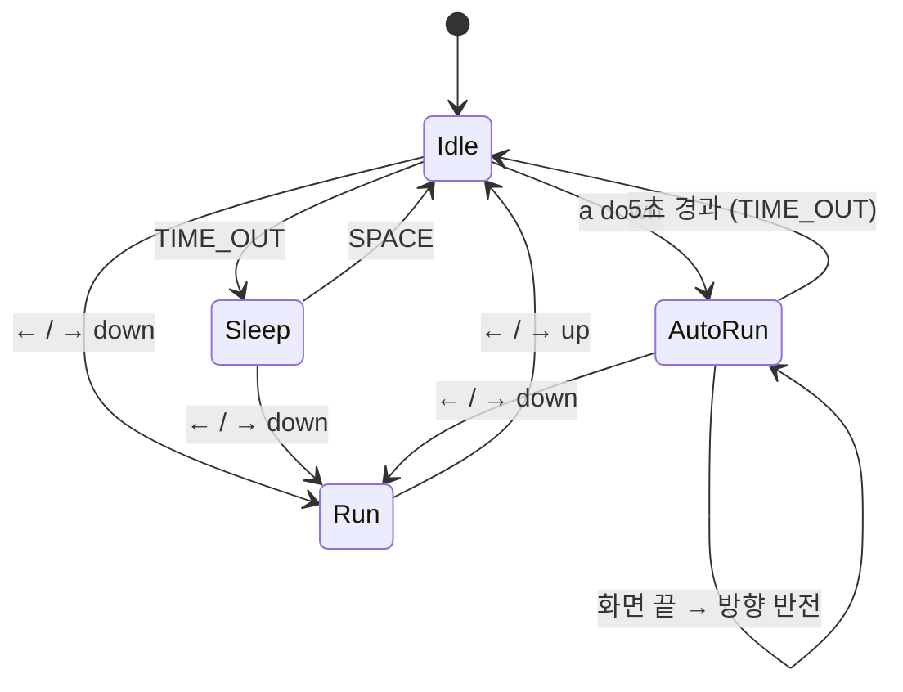

# PRD — Drill #11. 소년 자동 무적 런(AutoRun) 상태 추가

## 1. 개요

강의에서 만든 상태머신 기반 소년 캐릭터(Idle / Run / Sleep)에 **AutoRun(자동 무적 런)** 상태를 새 클래스로 추가한다.
`a` 키를 누르면 소년이 커지고 빨라져서 키 조작 없이 화면 좌우를 왕복하며, 5초가 지나면 Idle로, 방향키를 누르면 Run으로 돌아간다.

- 언어/라이브러리: Python 3 + pico2d
- 베이스 코드: 강의 저장소 `Labs/LEC12_CharacterController/boy_game.py` → LEC12/13 방식대로 `main.py` / `boy.py` / `grass.py`로 분리, `transitions` 라이브러리(`Machine`)로 Sleep·Idle·Run 상태머신 구성
- 의존성: `pip install pico2d transitions`
- 배점: 총 5점

## 2. 목표 / 비목표

**목표**
- `AutoRun` 상태 **클래스**를 추가하고 상태머신 전이 테이블에 연결한다. (필수 — 클래스 없이 if문으로 처리하면 안 됨)
- 상태 다이어그램 이미지를 저장소에 함께 올린다.
- 디스코드 공지된 제출 규칙을 모두 지킨다.

**비목표**
- "무적" 판정(충돌 무시 등)은 구현하지 않는다. 이 Drill에는 충돌 대상이 없으므로 이름일 뿐이다.
- 새 리소스(이미지/사운드) 추가는 하지 않는다. 기존 `animation_sheet.png`를 확대해서 그린다.

## 3. 상태 전이 명세

| 현재 상태 | 이벤트 | 다음 상태 | 비고 |
|---|---|---|---|
| Idle | `a` 키 down | **AutoRun** | 신규 |
| AutoRun | 시작 후 5초 이상 경과 (`TIME_OUT`) | Idle | 신규 |
| AutoRun | → 키 down | Run (오른쪽) | 신규, Run의 기존 enter 로직 재사용 |
| AutoRun | ← 키 down | Run (왼쪽) | 신규, Run의 기존 enter 로직 재사용 |
| AutoRun | 화면 좌/우 끝 도달 | AutoRun (방향만 반전) | 상태 전이 아님, `do()` 내부 처리 |
| Idle / Run / Sleep | (기존 전이) | (기존 그대로) | 변경 없음 |



> Idle/Run/Sleep 사이의 기존 전이는 베이스 코드에 있는 그대로 다이어그램에 옮겨 그린다. 위 그림의 기존 전이는 강의 코드 기준 예시다.

## 4. 기능 요구사항

### FR-1. `a` 키 → AutoRun 진입 (1점)
- `KEY_EVENTS`에 `(SDL_KEYDOWN, SDLK_a): 'a_down'` 추가
- 전이 테이블에 `add_transition('a_down', 'IDLE', 'AUTO_RUN')` 추가
- Idle 상태에서만 진입한다 (Run/Sleep에서 `a`는 무시).

### FR-2. AutoRun 시각/속도 변화 (1점)
- 이동 속도: 일반 Run보다 확실히 빠르게 (예: Run 속도의 2~3배)
- 크기: `clip_draw`의 출력 크기를 키워 확대 (예: 100×100 → 200×200)
- 확대 시 발이 땅에 붙어 있도록 그리는 y 좌표를 보정한다 (예: `y + 확대된 높이 차이 / 2`)
- 진행 방향에 맞는 애니메이션 행(오른쪽/왼쪽 run)을 사용한다.

### FR-3. 화면 좌우 끝에서 자동 방향 전환 (1점)
- `AutoRun.do()`에서 x를 매 프레임 `dir * speed`만큼 이동
- `x`가 오른쪽 끝(800 − 반폭) 이상이면 `dir = -1`, 왼쪽 끝(0 + 반폭) 이하면 `dir = 1`
- 방향 전환 후 x를 화면 안쪽으로 clamp해서 끝에 끼지 않게 한다.
- `face_dir`도 함께 갱신해, AutoRun이 끝나고 Idle로 돌아갔을 때 마지막 진행 방향을 바라보게 한다.

### FR-4. 5초 경과 → Idle 복귀 (1점)
- `AutoRun.enter()`에서 `boy.auto_run_start_time = get_time()` 기록
- `AutoRun.do()`에서 `get_time() - start >= 5` 이면 `boy.time_out()` trigger 호출
- 전이 테이블에 `add_transition('time_out', 'AUTO_RUN', 'IDLE')`

### FR-5. 방향키 → Run 복귀
- 전이 테이블에 `AUTO_RUN --right_down/left_down--> RUN`
- Run의 기존 `enter()`가 눌린 키로 방향을 정하므로 그대로 재사용
- Run으로 돌아가면 크기·속도는 원래대로 (AutoRun의 draw/do에서만 확대·가속하므로 별도 복원 코드 불필요)

### FR-6. 상태 다이어그램 (1점)
- 위 3절의 전이를 모두 포함한 이미지 파일을 저장소 루트에 커밋 (예: `state_diagram.png`)
- 기존 상태 + AutoRun + 각 전이 화살표에 이벤트 이름 표기

## 5. 구현 설계

- 상태마다 `enter / exit / do / draw`를 가진 클래스(`Idle`, `Sleep`, `Run`, `AutoRun`)를 두고, `STATES = {'IDLE': Idle, ...}`로 상태 이름과 클래스를 연결한다.
- 전이 테이블은 강의처럼 `transitions.Machine`의 `add_transition(trigger, source, dest)`로 등록한다.
- `before_state_change` / `after_state_change` 콜백에서 이전 상태 클래스의 `exit`, 새 상태 클래스의 `enter`를 호출한다.
- 키 입력은 `KEY_EVENTS`에서 trigger 이름(`a_down`, `right_down` …)으로 바꾼 뒤 `boy.trigger(name)`로 넘긴다. 시간 초과는 `do()`에서 `boy.time_out()`을 부른다.
- `ignore_invalid_triggers=True`라서 현재 상태에 등록되지 않은 이벤트는 무시된다.

```python
class AutoRun:
    @staticmethod
    def enter(boy, e):
        boy.dir = boy.face_dir          # 바라보던 방향으로 출발
        boy.auto_run_start_time = get_time()

    @staticmethod
    def exit(boy, e):
        pass

    @staticmethod
    def do(boy):
        boy.frame = (boy.frame + 1) % 8
        boy.x += boy.dir * AUTO_RUN_SPEED
        if boy.x > 800 - HALF_W: boy.x, boy.dir = 800 - HALF_W, -1
        elif boy.x < HALF_W:     boy.x, boy.dir = HALF_W, 1
        boy.face_dir = boy.dir
        if get_time() - boy.auto_run_start_time >= 5:
            boy.time_out()

    @staticmethod
    def draw(boy):
        row = 100 if boy.dir == 1 else 0
        boy.image.clip_draw(boy.frame * 100, row, 100, 100,
                            boy.x, boy.y + 50, 200, 200)

# 전이 테이블
machine.add_transition('a_down', 'IDLE', 'AUTO_RUN')
machine.add_transition('time_out', 'AUTO_RUN', 'IDLE')
machine.add_transition('right_down', 'AUTO_RUN', 'RUN')
machine.add_transition('left_down', 'AUTO_RUN', 'RUN')
```

- 클래스 구조·메서드 시그니처(`enter/exit/do/draw`, `@staticmethod` 여부)는 베이스 코드의 다른 상태 클래스와 똑같이 맞춘다.
- 상수 값(`AUTO_RUN_SPEED`, 확대 배율)은 실행해 보며 조정한다.

## 6. 엣지 케이스

| 상황 | 기대 동작 |
|---|---|
| AutoRun 중 `a` 다시 누름 | 무시 (타이머 리셋 안 함) |
| AutoRun 중 방향키 **up** 이벤트 | 무시 (Run의 key-up 처리와 꼬이지 않게 전이 테이블에 넣지 않음) |
| 화면 끝에 붙은 상태에서 AutoRun 진입 | 즉시 반대 방향으로 전환되고 끝에 끼지 않음 |
| AutoRun → Idle 복귀 | 원래 크기로, 마지막 진행 방향을 바라보는 Idle 애니메이션 |
| AutoRun → Run 복귀 | 원래 크기·속도, 눌린 키 방향으로 이동, 키를 떼면 Idle |
| Idle의 기존 TIME_OUT(→Sleep) 타이머 | AutoRun의 TIME_OUT과 섞이지 않음 — 전이 테이블이 현재 상태 기준이므로 OK, 단 Idle `enter()`에서 타이머가 다시 초기화되는지 확인 |

## 7. 인수 기준 (채점 기준 매핑)

- [ ] Idle에서 `a` → 소년이 커지고 빨라지며 자동으로 달린다 **(1점)**
- [ ] 5초 이상 지나면 Idle로 돌아간다 **(1점)**
- [ ] AutoRun 중 속도 증가 + 크기 확대가 눈에 보인다 **(1점)**
- [ ] AutoRun 중 화면 좌/우 끝에서 자동으로 방향이 바뀐다 **(1점)**
- [ ] 상태 다이어그램 이미지가 저장소에 있다 **(1점)**
- [ ] AutoRun 중 방향키 → 그 방향으로 움직이는 일반 Run으로 돌아간다
- [ ] `AutoRun`이 별도 클래스로 존재한다 (필수 조건)

## 8. 제출 요건 (디스코드 공지 반영)

- [ ] **Drill #11 전용 새 GitHub 리포지토리** 생성, 리포지토리 URL 제출 (브랜치 URL·커밋 URL 금지)
- [ ] 실행에 필요한 파일 전부 업로드: 모든 `.py` + 리소스(`animation_sheet.png`, `grass.png` 등) + `state_diagram.png`
- [ ] 리소스 경로는 **상대경로** (`load_image('animation_sheet.png')`) — 절대경로 금지
- [ ] 폴더 구조가 있다면 zip으로 묶어서도 제출
- [ ] 참고사항(조작법, 추가 구현 내용)은 **과제 제출란에 직접 작성**
- [ ] 다른 PC에서 클론 후 바로 실행되는지 확인

**제출란 참고사항 예시**
```
- 실행: python main.py (pico2d, transitions 필요)
- 조작: ←/→ 이동, a: 자동 무적 런(Idle 상태에서만), SPACE: Sleep에서 깨우기, ESC 종료
- AutoRun은 boy.py의 AutoRun 클래스로 구현, 상태 다이어그램은 state_diagram.png
```

## 9. 작업 순서

1. 강의 상태머신 소년 코드 + 리소스를 이 폴더로 복사, 그대로 실행되는지 확인
2. `a_down` 이벤트 함수와 `AutoRun` 클래스 추가, 전이 테이블 연결
3. 속도·크기·y 보정 값 조정, 엣지 케이스 확인
4. 상태 다이어그램 이미지 제작 (`state_diagram.png`)
5. 새 리포지토리 생성 → 커밋/푸시 → 클론해서 실행 확인 → URL 제출
